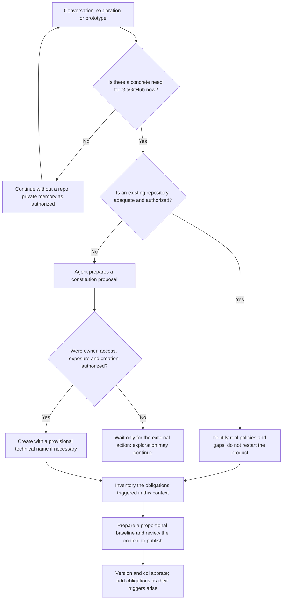

# Documentary contract: every record at its proper moment

**State:** proposal that is part of the workflow, still without automatic enforcement.

The [method's baseline](METHOD-BASELINE.md) establishes its own obligations:
METHODOLOGY, RULES, index and the prompt and template libraries, with AGENTS
before delegated execution in the repo and adapters/capabilities as they are
adopted. Do not confuse that prior infrastructure with forms demanded of the
human.

## 1. Mandatory for what, by whom and from when?

There is no universal package of Markdown files that every GitHub repository
must contain. README, license, CONTRIBUTING and ADRs are not, as a set, a
universal technical prerequisite for creating a repository. Confusing a
recommendation, a legal obligation, an organizational rule and a platform
requirement produces bureaucracy and false guarantees.

This contract distinguishes:

| Origin of the requirement | Meaning | Who resolves applicability |
| --- | --- | --- |
| Platform/tool | Technical requirement of the chosen operation | The person responsible for the integration verifies the actual tool and configuration |
| Organization | Real policy or rule of the repository/organization | The maintainer identifies the policy and its version |
| Legal/contractual | Obligation bound to rights, data, sector or contract | The competent person validates; the agent does not presume compliance |
| Method | Evidence this pipeline demands for a specific commitment | The product authority ratifies the adoption and the exceptions |
| Optional convention | Eases discovery, collaboration or automation | The maintainer adopts it when there is a benefit |

A conditional requirement may be non-negotiable once its trigger occurs. Not
being universal does not mean being dispensable. The list below is a base
catalog; sectors, organizations, stacks and tools may add requirements. Each
product's applicability inventory must capture those differences.

**The unit of obligation is the useful record, not necessarily a new file.** A
decision may live in an existing document or in a PR approval, provided it has
recoverable authority, revision, reason and reference. Private content may remain
in an authorized system, with a restricted-access reference; it must not be
copied to GitHub just to satisfy a check.

## 2. Before the repository: the right to an intent still without a name

The first space is a conversation, a notebook or a private workspace, with no
obligation of repo, branch, issue, final title or requirements language. Where
authorized persistent memory exists, the agent may prepare light syntheses. The
human need not fill in a template, approve every note or convert the discomfort
into a project. Without available persistence, the agent must make that limit
explicit when closing.

**A provisional descriptive name is not an identity decision.** The harness may
use an internal ID to recover the conversation. If the interface requires a slug
or a branch, it must supply one as a reversible technical detail, not block the
person with a question they have no answer to yet.

An existing repository for experiments does not imply a product commitment
either. Likewise, a ZERO may mature before there is any Git. When migrating it,
preserve provenance and identifiable ratification; do not invent a retrospective
SHA.

### Tree of repository constitution

Creating a repo, publishing content, changing visibility and granting access are
distinct operations. Authorization of one does not presume the others. The
technical name may be proposed by the agent; ownership, exposure and permissions
are not local choices it may silently assume.

## 3. Rules of birth, maintenance and waiver

For each triggered obligation, the agent keeps a record in the
[constitution inventory](templates/REPOSITORY-CONSTITUTION.md), or in the
equivalent canonical record that already exists:

- Trigger and the action that depends on it; origin of the requirement.
- Canonical artifact or evidence, revision, location and access.
- Who prepares, who decides and who consumes.
- State: `not triggered`, `pending`, `draft`, `under review`, `in force`,
  `not applicable with reason`, `authorized exception` or `superseded`.
- Validity: which change makes it outdated; when to review.
- Consequence of absence and, if admitted, the exception with authority and
  deadline/trigger.

`Not triggered` does not mean late. `Not applicable` is not an empty file. A draft
does not satisfy an approval requirement. A method exception does not waive a
legal or policy obligation its authorizer has no power to waive.

Documenting is, by default, assisted and visible work: the agent prepares and
maintains, making each document explicit in the chat. The human is called to
decide when there is a material interpretation, a reserved choice or a new
commitment. They need not ratify every editorial update, but neither may they be
kept unaware of it.

### Protocol of visible documentary elaboration

It applies to every documentary creation or alteration, including instruction
files, tool-generated specs and tasks, PR bodies and canonical records outside
Git. A generic message such as "I updated the documentation" is not enough.

| Step | What the agent makes explicit in the chat | Limit |
| --- | --- | --- |
| Before drafting | Name/path or record, reason and trigger, proposed content, sources and material doubts | Do not impose a form nor presume a human answer |
| While elaborating | What came from the human, what is evidence, inference, suggestion or unknown | Do not fill gaps with fabricated decisions |
| When presenting | Full content when short; when long, a substantive exposition per document with commitments, limits, divergences and access to the full text | A link, a diff or a list of files alone is not explicitation |
| When discussing | Human corrections and objections, open alternatives and their effect on the text | Absence of objection does not mean agreement |
| When saving | Identification of the version and its real state: draft, proposed or ratified with evidence | Saving may precede discussion only as a draft, never as a consummated decision |
| Before using as a commitment | Decision requested, authority, scope/revision and the approval actually received | Do not advance with a new commitment merely because the document was presented or merged |

Related documents may be presented in a single batch, provided each one is
identified and explained individually in the chat. In a batch, the rejection of
or request to correct one document suspends the other documents of the same
batch that depend on it, unless the human expressly authorizes partial advance.
There is no need to interrupt at every paragraph. In drafts not yet ratified, an
editorial update may be reported briefly; however, after a document is ratified,
any change in bytes is presumed material by default and requires a new
ratification, and the agent is prohibited from classifying an edit as "merely
editorial" on its own without an express human declaration.

For long documents, split the discussion into coherent parts when necessary,
without dumping text to obtain an exhausted "yes". Do not hide material
provisions in the file and ask for approval of a summary that omits them. The
human may request a full reading, contest a section, incubate the proposal or
return to exploration. They are not obliged to edit Markdown in order to
participate.

**Distinct states:** proposal drafted, content presented, human response received
and commitment ratified are different events. The agent may record what it
presented, but may not claim the human read, understood or agreed without a
corresponding manifestation. Acceptances may cover a bounded set of documents and
revisions; they do not extend to indiscriminate future changes.

**Minimum trail per document:** reference to the originating dialogue, the version
or content presented, relevant sources/interpretations, open points and any human
decision. Use metadata or an existing canonical record, without transcribing
private conversations. If the chat offers no stable links, record date, context
and a minimal identifiable excerpt or an authorized reference; do not invent an
identifier nor publish private content to simulate traceability.

**Automatically generated content:** inventories, references and notes may be
generated under a mandate, but their document and relevant delta are still
presented in the chat; the agent does not invent reading or approval of every
line. Raw technical artifacts, such as logs, binaries and full test results, may
be referenced with an explanation of their function, result and limitations,
without full transcription. This distinction does not allow hiding specs,
decisions or policies as "generated output".

**Correction of invisibility:** if a document was already written without this
dialogue, present it individually, make its choices explicit and keep pending any
ratification not obtained. Do not backdate awareness or approval. This proposal
and the templates already prepared are also subject to this rule.

## 4. Temporal matrix: before, during and after

In the rows below, the method's requirements govern the product only after its
adoption. No row demands redoing phases that already have adequate evidence.

| Moment / action | Antecedent record | Record during or after | Responsibility / consumption | What is blocked if it is missing |
| --- | --- | --- | --- | --- |
| Express a discomfort | No form | Light memory if desired and authorized | Agent welcomes; human explores | Nothing: the conversation continues |
| Brainstorm / ideation | Available context, even incomplete | Selective synthesis, alternatives and tensions in an EXPLORATION | Agent prepares; human corrects meaning when necessary | Do not declare a convergence that does not exist |
| Grill me session | Agreement on goal, intensity and stop, which may be in the conversation | Relevant objections, answers and unknowns in the same exploration | Interlocutors; the consumer is the next decision | Do not impose an unagreed provocation |
| Research / reverse engineering | Question and limits of access, use and spend when applicable | Sources, dates, provenance, licenses/limits and inferences | Agent researches; the responsible person validates material decisions | Do not claim a discovery without a source nor overstep the authorization |
| Prototype / experiment | Hypothesis/question, limits and procedure proportional to risk | Result, evidence, limitations and destination of the artifacts in an EXPLORATION | Executor prepares; the decider uses the learning | Do not run external effects without authorization nor promote code automatically |
| Pause / abandonment / resumption | No compulsory justification | State and minimum context for resumption, if memory is desired | Agent preserves; human chooses to continue | Nothing obliges building |
| Compaction / succession of a session agent | Existing persistent records and current state; memory contract | Checkpoint of the two names, hook result and real recovery receipt | Predecessor agent/adapter preserve; successor checks | Do not declare guaranteed continuity with a missing/partial package; containment depends on the harness's real capability |
| Constitute a repo / incorporate into an existing repo | Reason, destination and applicable authorizations; existing policies | Constitution and applicability inventory | Agent proposes; owner authorizes; maintainer uses | Only the repo operation without authorization; not the exploration |
| First shared versioning | Review of publishable content, rights and secrets; triggered baseline | Factual README, ignore rules and applicable provenance record | Maintainer and collaborators | Publication of unauthorized or sensitive material |
| Found a product commitment | Selected exploration or provenance of a received decision | ZERO, gaps, residual risk and ratification of the revision | Agent drafts; human authority ratifies | Do not start productive execution under an intent not yet ratified |
| Propose a change of intent | Current ZERO and the motivating signal | requirement-NNNN; amendment to the ZERO if it alters the foundation | Product authority and future reviewers | Do not present a change of contract as mere execution |
| Preflight / temporal simulation | Candidate requirement, relevant decisions and risks | Scenarios, premises, limits, results and routing | Agent prepares; authority accepts risks within its domain | The decision affected by a blocking gap; not all activity |
| Take a relevant architectural decision | Options, forces and proportional consequences | Accepted ADR and reference to the decision/revision | Identified decider; specs and maintenance consume | Do not treat a proposal as an accepted decision |
| Specify | Requirement ratified for execution; drafts may elaborate it beforehand | Native specs, criteria and coverage map | Agent specifies; the responsible person resolves conflicts | Do not execute a divergent contract or one without material coverage |
| Delegate tasks | Specs, dependencies and execution limits | Canonical tasks and mandate in the bridge | Human authorizes reserved decisions; agent executes | Execution outside the mandate, not delegated local choices |
| Open a working branch | Need to isolate/version a change and existing rules | Reference to the initiative in the PR or equivalent metadata | Agent may suggest/generate a technical name | Do not demand a naming choice as a product decision |
| Implement / fix | Current criterion, task and mandate; for a bug, reproduction of the violated contract | Code, tests and execution evidence | Executor; review and CI consume | Claiming a fix without evidence or silently altering the contract |
| Open a PR | Real diff, origin of the scope and available references | PR body, checks, risks and decision requests | Author prepares; reviewers and CI consume | Merge before the applicable conditions; a draft may exist with explicit open points |
| Review / request changes | Concrete review of the PR and evidence | Review, threads, replies and GitHub's native open items | Authorized reviewers; author responds | Do not simulate approval nor resolve a divergence by deleting the record |
| Merge | Current checks and authorizations, resolution of blocking items | Merge/SHA and relation to delivery | Authorized integrator; release consumes | Integration without the criteria in force; merge does not mean deploy |
| Release / migrate | Identified artifact, release plan, recovery, observation and authorization | Release/deployment, applied migration and DEL record | Person responsible for release/operation | Unauthorized release or one without treatment of material risks |
| Observe / learn | Defined signals, source, window and responsible person | Real result in the DEL; new requirement if necessary | Operation/product; the next exploration consumes | Do not declare a benefit without observation |
| Respond to an incident | Channel, responsibilities and applicable runbook already prepared | Timeline, containment, restricted evidence and proportional learning | Incident owner; pertinent authorities | Do not delay containment to fill in a report; do not waive a required authorization |
| Discontinue / archive | Impact on users, data, obligations and an authorized plan | Applicable notices, data destination, support and updated documentation | Owner and competent responsible persons | Do not confuse abandoning an idea with shutting down a service in use |

The [handoff record](templates/PASSAGE-RECORD.md) supplies the common fields
when no canonical support exists. One does not create a file per click, command
or comment: only decisions, transitions and evidence that need to survive.
## 5. Catalog of repository files and configurations

The paths are suggested destinations for the adopting product, not files all
installed by this proposal. Where indicated, the requirement is the content; a
canonical equivalent avoids duplication.

| Artifact / suggested location | Origin and trigger of enforceability | Preparation / authority | Maintenance and limit |
| --- | --- | --- | --- |
| `METHODOLOGY.md` | Method: adoption of the methodological infrastructure, even before the product repo | Agent presents; the person responsible for the method decides | Entry door to the canonical cycle, without duplicating it |
| `RULES.md` | Method: before assisted work governed by the method | Agent presents; authority defines the rules | Separate rules, decisions and real permissions |
| `INDEX.md` or an identified canonical map | Method: documentary baseline adopted | Agent maintains with explicitation in the chat | References and responsibilities; an index does not prove reading |
| `prompts/` library | Method: reusable infrastructure; scripts instantiated per activity | Agent proposes; the responsible person adopts | A prompt is neither a filled-in document nor an installed command |
| `templates/` library | Method: availability of records by trigger | Agent maintains; the person responsible for the method | Do not demand early filling nor generate documents silently |
| `CLAUDE.md` and other specific adapters | Conditional: the adopted integration requires its own discovery/format | Maintainer validates; agent prepares | Route to the canonical rules, without a competing policy |
| Inventory of skills and MCPs | Conditional method: before adopting/altering the capability | Agent presents provenance and contracts; authority authorizes actions | State, access, effects, install/removal; do not version credentials |
| `sledge-handoff.md`, `DIAMOND.md` | Method: persistence and handoff before compaction; particular functions not yet defined | Predecessor preserves; successor recovers; the human defines future semantics | Proposed private location in `.session-memory/`; do not fabricate content nor publish automatically |
| Checkpoint envelope and receipt | Method: coherence and verifiable recovery of the handoff | Adapter/agents; real result of the hook | Contract in SESSION-MEMORY; ignore guarantees neither retention nor transport between worktrees/hosts |
| `llms.txt` / `robots.txt` | Convention/web context, when purpose and consumers justify it | Person responsible for publication | Guidance for LLMs and crawling are distinct functions; they neither control access nor govern local execution |
| `README.md` | Method: first versioned sharing | Agent prepares; maintainer answers for the content | State provisional purpose, maturity and guidance; update with real use/installation, without demanding a commercial name |
| `.gitignore` and local exclusion rules | Method: before versioning generated, local or sensitive artifacts | Agent proposes per stack; maintainer reviews | Adjust with tooling; ignore neither removes an already tracked secret nor replaces the response to an exposure |
| `LICENSE` / `LICENSES/` | Conditional: licensing decision and applicable rights before distributing under a declared license | Rights holder or competent authority chooses; the agent does not invent a license | Update when distribution/rights change; a public repo is not equivalent to an open license |
| `NOTICE`, attributions and third-party notices | Legal/contractual when the licenses of incorporated material require it | Person responsible for distribution validates; agent inventories | Re-examine dependencies and redistribution; do not presume a universal NOTICE |
| `docs/requirements/REQUIREMENT-ZERO.MD` | Method: first product commitment, not repo creation | Agent synthesizes; the authority over the intent ratifies | Amend explicitly when the foundation changes |
| `docs/requirements/requirement-NNNN.md` | Method: change/expansion of the intent | Agent prepares; product authority ratifies | State, bindings and effects on the ZERO; a bug that restores a contract requires no new requirement |
| `docs/explorations/EXP-NNNN.md` | Method: selected learning must sustain a future decision | Agent synthesizes within publication limits | May be born outside the repo and receive an ID later; transcription is not an obligation |
| `docs/decisions/ADR-NNNN.md` | Conditional method: material decision with persistent consequences | Agent prepares; competent decider accepts | Record supersession and review conditions; do not demand an ADR for every task |
| The executor's native specs, plan and tasks | Method: before the corresponding execution | Agent prepares; the responsible person accepts the contract and the mandate | Paths defined when choosing the executor; do not create a second source of truth |
| Execution bridge and mandate | Method: before an autonomous stretch | Agent proposes; the delegating authority authorizes | Review with new scope, evidence or limits |
| `CONTRIBUTING.md` | Conditional method: before opening contribution to other people/agents | Maintainer establishes; agent documents | Setup, tests, branches, PRs and review; not demanded of the author of an idea |
| `CODE_OF_CONDUCT.md` | Conditional: community/organizational policy before opening a community under that policy | Those responsible for the community define text and enforcement | Real channel, responsible persons and procedure; do not invent a moderation commitment |
| `SECURITY.md` | Conditional method: before making software available to external users | Security maintainer validates | Reporting channel, supported versions and real process; do not publish private vulnerability details |
| `SUPPORT.md` or a canonical support section | Conditional method: before inviting users to depend on the software | Person responsible for support | Channels, limits and support cycle; avoid promising a non-existent SLA |
| `CODEOWNERS` in a location GitHub recognizes | Conditional: when the flow uses routing/review by code owners | Maintainer validates real owners | Syntax, coverage and permissions; the file alone does not require approval |
| `.github/ISSUE_TEMPLATE/` and associated configuration | Optional or organizational: when structured intake helps coordination | Maintainer defines the useful minimum | Distinct templates for bugs and proposals; do not convert early exploration into a mandatory form |
| `.github/PULL_REQUEST_TEMPLATE.md` or PR templates | Optional or organizational: when standardizing evidence helps review | Maintainer; agent adapts the DEL block | The method requires applicable information in the PR, not this specific file |
| `AGENTS.md` and instructions of adopted tools | Conditional method: before recurring delegated execution in the repo | Maintainer defines the contract; agent prepares | Real commands, scope, limits and canonical sources; do not duplicate divergent policies or secrets |
| Manifests, lockfiles and build/test configuration | Technical/organizational per stack: before a reproducible build and the corresponding CI | Engineering owner | Record runtime version and commands; lockfile only where the ecosystem/project adopts it |
| `.env.example` or an equivalent configuration contract | Conditional method: when setup requires external variables | Agent documents names and innocuous examples; maintainer validates | Never real values; secrets in an authorized mechanism, not in Git |
| `.github/workflows/*.yml` and invoked scripts | Technical: when adopting GitHub Actions; method: CI before integrating productive code | Maintainer authorizes the policy; agent implements | Real events, permissions, checks and dependencies; do not install an empty workflow as compliance |
| Rulesets/branch protection, environments and permissions | Organizational/method: before depending on merge/deploy gates | Authorized administrator configures | These are remote configurations, not proof by file; inventory the effective rule and the plan's limitations |
| Dependency update configuration, such as `.github/dependabot.yml` | Optional or organizational: when adopting the corresponding automation | Maintainer | Equivalent alternatives are valid; alerts do not replace response and triage |
| `CHANGELOG.md` or canonical release notes | Method: before announcing a version with impact on users | Agent prepares from the diff; the person responsible for the release validates | One canonical source; include incompatibilities and migration, without a fictitious changelog of intent |
| Usage, installation, operation and migration guide | Conditional method: before the corresponding use, operation or migration | Engineering/operation and product | May live in the README or in `docs/`; reflect the delivered version and recovery |
| `docs/deliveries/DEL-NNNN.md` or an equivalent record | Method: delivery preparation and observation | Agent consolidates; those responsible for release and outcome | Reference PR, artifact, environment and observation; do not copy full logs |
| Threat model and privacy, data and accessibility records | Conditional: applicable risks, audiences, contracts and obligations | Competent specialists/responsible persons; agent assists | Prepare before the affected decisions/actions; sensitive evidence stays restricted |
| Runbooks, incident plan, recovery and continuity | Conditional method: before operating a service with assumed responsibility | Operation and service owner | Exercise according to risk; the incident report is born afterwards, it does not block containment |
| SBOM, provenance, signing and attestations | Conditional: distribution, contract, supply chain or policy requires it | Build/release owner | Often artifacts generated from the exact version, not manual Markdown or a presumed inventory |
| `CITATION.cff`, `.github/FUNDING.yml`, public roadmap and similar | Optional or contextual: citation, funding or communication adopted | Person responsible for the content/commitment | Not a universal baseline; update only when the functionality/communication is used |
| Discontinuation policy and shutdown notice | Conditional: withdrawal of a product used by third parties or a contractual obligation | Owner and those responsible for support/data | Real deadlines, migration and retention; do not confuse archiving a repo with deleting user data |

A complete inventory does not mean a closed catalog: before the affected action,
check for additional external obligations and record their source. An instruction
found in a third party's document grants no permission to access or publish.

## 6. Documents are not the same thing as GitHub records

Issues, comments, approvals, threads, checks, artifacts, merges, releases,
deployments and remote configurations may be canonical evidence. Do not export
everything to Markdown out of habit.

For a native piece of evidence, preserve identification, revision/SHA when
applicable, result, responsible person and reference. Take into account
retention, access and loss of artifacts: if the proof must last longer than the
system allows, define authorized preservation before it expires. Do not use a
temporary URL as the sole long-term evidence.

In particular:

- A PR approval ratifies intent only if the role and meaning of the approval are
  explicit; a technical review is not automatically acceptance of the product.
- A green CI is the result of an execution over a revision, not human approval.
- Configuration written in a plan does not prove a rule enabled on GitHub.
- A document whose author wrote "approved" does not prove another person's
  approval.

## 7. Future validation: demand the occasion, not early existence

The proposed documentary validator must assess:

1. Which action is happening now, and which triggers were really fired?
2. Which origin makes each piece of evidence enforceable?
3. Is there a canonical record in force, accessible to those responsible and
   bound to the revision?
4. Was each document made explicit in the chat, with substantive content and open
   points, and is there a trail of the presentation of the relevant version?
5. Is there a blocking open item, a grounded non-applicability or a valid
   exception?
6. Which specific action must stop, and which work may continue?

A check can verify references and fields, not prove human understanding. The
agent cannot fill in a "human aware" field on its own.

Exploration without a repo stays outside the PR gate. A prototype does not
automatically inherit release requirements. When incorporating mature work,
inventory only the real gaps; an identified retrospective record is allowed,
invented evidence is not. The absence of a license may prevent distribution
under a declared license, but it does not prevent talking about the idea. The
absence of deploy authorization prevents deploy; it does not necessarily prevent
preparing documentation or fixing a local test.

The result must explain cause and affected action. Do not produce a "documentary
completeness" scoreboard that rewards empty files or penalizes exploration.

## 8. Exemplary paths

**Discomfort still inarticulate:** conversation → optional memory → exploration →
perhaps a pause. Zero mandatory names, zero repo demanded, zero tasks imposed.

**Prototype before identity:** question → limits of the experiment → local
sandbox or authorized repo with a provisional ID → result → discard or synthesize
a ZERO. Experimental code does not become a commitment by existing.

**Product with a mature direction:** provenance → ratified ZERO/requirement →
inventory of triggered obligations → existing or supplemented decisions/specs →
mandate → implementation → PR → merge → delivery → observation.

**Fix in an existing product:** current contract → reproduction → task under a
mandate → test/fix → PR/review → delivery. No new ZERO nor new requirement,
unless the solution changes the intent or the contracted behavior.