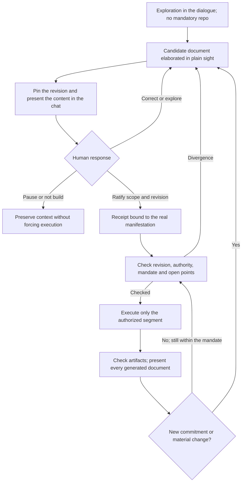

# Adaptation to Spec Kit — the passage between conversation and execution

**Repository constituted by human decision:** `mardemsean/smard-agent-flow-git` (originally cited in the earlier handoff as `smard-agent-flow-kit`).
**State:** corrected preflight and integration proposal, not an implementation.
**Origin:** human request of 2026-10-16 to correct the end-to-end passage, after
reading the 10:37 handoff, the PONTE map and the adversarial opinion.
**Elaboration in the chat:** correction proposal made explicit before this text
was drafted; the details below are the agent's recommendations, not presumed
human choices.

## 1. Scope and provenance

This document complements the [baseline](METHOD-BASELINE.md) and corrects the
external map `SPECS-TASKS-BRIDGE--smard-agent-flow-kit.md`, without overwriting
it or importing private memories into the repository. In any divergence between
the earlier external map and this document, this `SPECKIT-ADAPTATION.md` prevails.

The handoff records decisions taken in another session: Claude Code as the
integration; configuration before a fork; the possibility of a Python step type of
our own; reassessment of a fork after three satisfactory small pilots;
`agent-context` for context sections; memory via a Claude hook outside the
executor. These are decisions **reported by the predecessor**, whose original
conversation was not consulted. This document does not turn them into
authorization to install.

The native-gate option was recorded in that map, but it depends on a fit the
handoff itself left unresolved. Preserve the intent of human ratification; do
not treat the mechanism as technically solved.

### Evidence consulted and its limit

Files were read from the local snapshot attributed to
`96774bc52fd7dccc7185791e1cac7572b9e09dea`, together with the documentation and
implementation of the gate and command dispatch. The hash of the original
package was not re-checked, nor was it demonstrated that the extracted content
corresponds to that commit: the directory consulted contains no usable Git
metadata. Before any executable pilot, it is mandatory to verify that hash
against an intact Git checkout and to pin the exact version of the tree
(`workflows/step/` vs `workflows/steps/`). The findings below concern the local
files actually read, not the current version on the internet.

The memory files cited in the capture were located. Their reports and
preferences guide the resumption, but they neither replace a technical source
nor grant new permissions. They do not redefine the functions of the two
persistent records.

## 2. Factual corrections with excerpts from the source

The locators below are relative to the root of the Spec Kit snapshot. Excerpts
are evidence of contract or implementation read; tests were not executed.

| Topic | Source and literal excerpt | Consequence for the design |
| --- | --- | --- |
| Skills in Claude | `docs/reference/integrations.md:13`: “Skills-based integration; installs skills in `.claude/skills`.” | A loose skill does not prove execution of a workflow |
| Workflow and integration | `design/workflow-step.md:3–6`: “distinct from an agent integration: integrations dispatch work to an agent; steps validate and execute workflow behavior.” | Separate interlocution, dispatch and transition control |
| A gate is not limited to a yes/no without a document | `src/specify_cli/workflows/step/gate/__init__.py`, `GateStep.execute`: “`show_file` contents are folded into the displayed message” | It can display a file in the interactive terminal; the earlier opinion omitted this capability |
| Without an interactive terminal | Same file, before returning `PAUSED`: “Non-interactive: pause for later resume (the file is not read here)” | A pause of the engine does not prove presentation of the document in the chat |
| Presentation limit | `GateStep.MAX_SHOW_FILE_LINES = 200`; `_read_show_file` describes a warning when the file cannot be read | Files over 200 lines are truncated in the interactive terminal and are not even read outside a TTY; `show_file` never replaces presentation in the chat (R2) |
| Verdict by input | `docs/reference/workflows.md:1177–1182`: “Gate auto-decides”; “A non-empty `default` is consumed as a verdict on the first run” | Never fill in an approval in advance nor confuse an input with an authenticated human manifestation |
| Prior validation and `on_reject` | `src/specify_cli/workflows/step/gate/__init__.py:56–64, 85–94`: the engine does not self-validate before `execute`; `on_reject: retry` clears the bound input (`:210`) and requires `""` in the enum (`engine.py:528–553`) | Make `specify workflow validate` mandatory before every execution and require `on_reject: abort` on ratification gates |
| Interruption and end of input | `src/specify_cli/workflows/step/gate/__init__.py:257–287`: `Ctrl+C` re-raises and pauses the run (`PAUSED`); `EOF` resolves as rejection | Treat `EOF` as an effective rejection and `Ctrl+C` as a pause that requires a new presentation/decision before resuming |
| Run state in plain text | `src/specify_cli/workflows/engine.py:776–777, 1195`: `state.json` and `inputs.json` are written as plain JSON | Prohibit the agent from editing `state.json`/`inputs.json` or from triggering `specify workflow resume` with an approval verdict |
| Resume | `docs/reference/workflows.md:85–88`: “Updated values affect only unfinished work; completed steps and calls are not reinterpreted or repeated” | A completed verifier does not re-validate altered files merely because a resume occurred |
| Agent context | `design/integration.md:378–382`: “The opt-in `extensions/agent-context/` owns their defaults”; “`specify init` does not enable the extension implicitly” | Adoption requires an explicit operation; do not take ownership of the whole CLAUDE.md |
| Conditional hooks | `templates/commands/specify.md:30`: “If the hook defines a non-empty `condition`, skip the hook” | Do not promise automatic hook enforcement by the template |
| Composition | `docs/reference/presets.md:292`: “wrap replaces `{CORE_TEMPLATE}`”; “script wrappers use `$CORE_SCRIPT`” | Distinguish templates/commands from scripts; composition is not a gate |
| Installation source | `docs/reference/extensions.md:207`: “Do not flip a discovery-only catalog to `install_allowed`.” | Discovery does not authorize installation; a trusted source needs its own assessment |
| Command output | `src/specify_cli/workflows/step/command/__init__.py`: the docstring says “Full `stdout`/`stderr` capture is a planned enhancement”, yet lines `172–173` already write `output["stdout"]` and `output["stderr"]` from `dispatch_result` | The textual contract declares capture pending while the code already writes the keys according to the integration; do not presume capture is ready without verifying the specific integration (§8) |

The code observed organizes types under `workflows/step/`, while the design
consulted mentions `workflows/steps/`. Do not copy implementation paths without
checking the real tree. Discovering that divergence is one more reason to pin and
verify the version before programming the adapter.

**Conclusion:** the native gate is useful, but by itself it does not implement
the method's ratification contract. Nor was it demonstrated that Python is
mandatory in any pilot. A verifier can prove bindings and integrity; it cannot
infer human understanding or create a trusted source of approval.

## 3. Recommended architecture: continuous dialogue, segmented execution

Do not recommend an exclusive choice between "skills only" and "the engine
governs everything". The dialogue is the human interface of the method; the
engine may execute bounded segments after adequate commitments. A skill may help
elaborate or present a document without that granting it release authority.

### One concrete passage

1. The agent states that it is preparing the ZERO and with which sources and
   open points.
2. It persists an identified candidate, still without approving it.
3. It pins the candidate content and presents its substance in the chat, with
   access to the full text and without hiding limits or disagreements.
4. It asks for an isolated decision about that content, not about "continuing
   the workflow".
5. It records the effective response and the authorized scope. Correcting,
   pausing or rejecting do not convert into approve.
6. It checks that the current revision matches the one presented and ratified.
   If it changed materially, it reopens the discussion; it does not reuse the
   earlier acceptance.
7. It authorizes only the next segment: for example, elaborating specs under the
   ZERO, not implementing, merging or publishing.
8. The segment produces candidate specs/plans. The agent presents them
   individually in the chat (through artifact reading/capture still to be
   defined per §8), makes new choices explicit and returns to the applicable
   commitment. In a batch of several documents, the partial rejection of any
   item blocks the advance of the other dependent items, unless the human
   expressly authorizes otherwise.

The initial exploration phase in the dialogue (node `A`, corresponding to the
pre-repository space protected by rule R1) remains entirely free of hashes,
digests or bureaucratic receipts: the goal is to protect the freedom of thought
of the `HOMUS-FIATIVUM`. The obligation of a snapshot with a digest is born only
when a candidate document (such as the `REQUIREMENT-ZERO.MD`) starts to be
drafted and pinned in nodes `B` and `C`, carrying in its header the sources and
open points that came from the exploration.

Architecture details, mandate and criteria may require their own acceptances.
Do not place a single approve at the start of a specify → plan → tasks →
implement run and treat it as authorization for all future documents.

## 4. Minimum contract of the ratification

The [receipt template](templates/DOCUMENTARY-RATIFICATION.md) represents the
binding, not a ready executable authorization. It may be part of an existing
canonical record.

The binding must identify:

- The initiative, document or bounded set and the exact revision presented.
- The pinned content: a recoverable snapshot and a mandatory `SHA-256` digest
  computed over the exact bytes written to disk (no normalization), recording
  the encoding (`UTF-8`) and the line-ending pattern (`LF` or `CRLF`) to avoid
  false divergences caused by `core.autocrlf` on Windows; the Git SHA when
  applicable. The HEAD SHA alone does not identify a modified or untracked file.
- The binding with the execution in the engine: `run_id`, the gate's `step_id`,
  the name of the `verdict_input`, the resume command and the exit state, plus
  the originating session or handoff, preventing a receipt from being reused in
  another run.
- The presentation event in the chat, the content covered and the presentation
  open points.
- The real human manifestation, its origin, identity/role, the decision with its
  reservations and a verifiable binding with the response (`SHA-256` digest of
  the human message + timestamp + channel kept in authorized private storage,
  without copying private text into public documentation).
- The authorized scope, excluded actions, validity and the conditions for
  reconsideration or revocation (event, actor and date).
- The check immediately before use and the next authorized segment.

A hash proves neither truth nor consent; it identifies bytes. Do not include the
document's hash inside the same bytes it intends to identify: the receipt is
external to the candidate snapshot. A batch uses an explicit list of paths and
digests.

Any post-ratification alteration also alters bytes and **is presumed material by
default**, requiring a new presentation and a new human ratification. The agent
is prohibited from classifying a post-ratification edit as "merely editorial" on
its own to bypass a new acceptance; only the human may declare a change
editorial, and even then the new snapshot and its `SHA-256` digest are recorded.

The presentation record distinguishes the agent's declaration from an event
observable in the interface. The decision receipt references the human response;
a field `approved: true` written by the agent itself is not enough.

### Trust boundary and access

In Path A (and in any flow without an isolated technical channel), if the
executing agent had permission to send the resume verdict, it would itself be the
translator of the human response for the engine. For that reason, **the central
operational rule is that the agent is strictly prohibited from executing
`specify workflow resume --input <verdict>=approve` or from editing `state.json`
/ `inputs.json`**. Whoever runs the resume command (or supplies the verdict to the
engine) after reading the document in the chat is exclusively the human operator.

Furthermore, while the receipt operates at `Assurance level = assisted`, any
automatic transition to irreversible segments or segments with external effect
(`implement`, `merge`, `deploy`, `publish`) is structurally blocked. Strong
enforcement depends on a decision channel and an access policy outside the
exclusive control of that agent. Do not claim a signature or authentication the
interface does not offer.

If the chat exposes no stable event or authorized export, record that limitation
and use explicit assisted checking in the pilot. Do not invent a chat ID nor send
conversations to external services to fabricate evidence. If the policy requires
independent proof that is unavailable, the affected segment stops.

Private receipts and transcripts remain in authorized storage; public
documentation receives only an appropriate synthesis and safe references. Private
source files must not be copied into this repository.

## 5. Fitting into the engine without attributing non-existent powers

### Path A: assisted pilot, without a Python step of our own

Exploration, presentation, decision and revision checking happen in the
dialogue. After a real human manifestation, **the human operator personally
triggers the resume** (or authorizes the exclusive start of the bounded segment).
Native gates pause segments and wait for the human verdict; the agent is
prohibited from injecting the verdict into the terminal on the human's behalf.

It is a legitimate pilot of experience and traceability, **not independent
technical enforcement**, which is why the `assisted` level forbids irreversible
stages. If the engine's gates are used, there must be a real execution of the
workflow; loose skills do not count as execution of those gates.

### Path B: the same contract with deterministic verification

If the pilot requires or justifies automation, a single step **type** of our own
may have several occurrences (positioned immediately after each gate and before
each dispatch) to check receipts, `run_id`, sources and `SHA-256` digests at each
boundary. That does not mean a single check at the start of the whole execution.

The step receives an explicit contract of inputs: candidate revision, receipt,
admissible decision origin, policy, scope and the context of the occurrence. It
fails on absence, divergence, revocation or an untrusted source according to the
policy; it does not replace a gap with success.

Without a trusted evidence interface, the step does not resolve the approval: it
limits itself to structural integrity and records the assisted character of the
decision.

### Using the native gate on the chosen path

- Mandatorily run `specify workflow validate` before any workflow execution,
  because the engine does not self-validate the YAML before `execute`.
- Mandatorily configure `on_reject: abort` on every documentary ratification
  gate; never use `on_reject: skip`. If `on_reject: retry` is studied in the
  future, remember that the engine requires `""` in the verdict enum.
- Initialize every verdict input empty; do not reuse an approve across gates.
- In no-TTY mode, wait for `PAUSED`, present the document in the chat and wait
  for the human operator to personally run the resume command after deciding.
- When `show_file` is used in an interactive terminal, point it to the path of
  the immutable snapshot referenced in the receipt, never to a mutable working
  file subject to a race between display and use.
- Never rely on `show_file` to satisfy rule R2: it truncates files over 200
  lines (`MAX_SHOW_FILE_LINES = 200`), does not read the file in no-TTY mode and
  does not prove presentation in the chat. Documents over 200 lines always
  require structured presentation in the chat outside the gate.
- Treat `EOF` at the gate as rejection and `Ctrl+C` as a pause (`PAUSED`) that
  requires a new check before resuming.
- Keep gates out of fan-out; the documented contract does not support
  `verdict_input` in that context. Do not parallelize human ratifications by
  default.

### Resume and change after approval

The engine reuses completed occurrences. Therefore a check before a gate will not
necessarily be repeated after a pause. The check must happen on the not yet
completed side of the boundary, and again before each action that depends on the
revision. Check immediately before dispatch or execute over a controlled immutable
snapshot; a separate check of a mutable file does not eliminate the race between
verification and use.

If a paused or failed action is going to be resumed after a material change in
its inputs, interrupt that lineage and generate a new revision/segment, instead
of expecting resume to reinterpret completed steps. The design of locks,
snapshots and isolation remains an implementation requirement, not a native
capability demonstrated here.

## 6. Corrected map of the method onto the executor's surfaces

| Part of the method | Candidate fit | Limit and open point |
| --- | --- | --- |
| METHODOLOGY/RULES/AGENTS | Canonical sources of their own; context via opt-in `agent-context` if adopted | Do not silently replace the canonical rules with the constitution |
| The executor's constitution | Explicit derivation of the principles applicable to the specified work | A document of its own, presented in the chat, with an origin map and without replacing the ZERO |
| Exploration, grill me and ZERO | Dialogue and candidate extension scripts/skills | Names/IDs and installation not yet defined |
| Numbered requirements | Canonical documents of the method and a possible support command | Do not confuse the change sequence with the executor's feature/branch |
| Preflight and ADR | Templates/extension support, with a bound human decision | A gate is a possible mechanism, not the whole contract |
| Specify/plan/tasks | Local overrides for a small pilot or a preset for reuse | Verify format, priority, materialization and provenance of the composition |
| Bridge/mandate | References to native specs/tasks and an authorization record | Do not assume plan.md/tasks.md by themselves preserve the whole mandate |
| Implementation | Segment bounded by criteria, mandate and revision | Ends before new unauthorized decisions |
| GitHub and delivery | Corresponding integration plus PR, review and DEL records | `taskstoissues` does not implement review, merge, release and observation in full |
| Session memories | Contract of their own and a future Claude hook outside the engine | Model compaction and workflow checkpoint/resume are different mechanisms |

`wrap`/`prepend` remain choices pending experiment, not decisions taken here. A
local override may be simpler in the pilot; a reusable package requires a
verified contract of distribution, ownership and removal.

The installation source remains pending. Do not enable the community catalog for
installation. Evaluate a local source or a specific verified artifact before
asking for operational authorization. Do not run init/add/install in this
preflight.

Migrating an extension/preset to a fork may require adapting registration,
structure, ownership and tests. The earlier promise of "nothing disposable, no
rewriting" is not a demonstrated guarantee; reuse is a goal to be measured in
the pilots.

## 7. Verification required before an executable pilot

| Case | Expected result |
| --- | --- |
| Candidate presented and ratified, revision unchanged, mandate valid | Only the authorized segment may start |
| File not yet presented, receipt missing or ambiguous response | Do not convert into approval |
| Response rejects, asks for correction or pauses (or partial rejection in a batch) | No dispatch authorized by that gate; `on_reject: abort` ends the segment |
| File changes after presentation/acceptance (even under a claim of editorial adjustment) | Binding invalid; a material change is presumed and a new human ratification is required (unless the human expressly declares an editorial edit with a new `SHA-256` digest) |
| Line-ending difference (`CRLF` vs `LF`) on Windows | `SHA-256` digest computed over the exact bytes written to disk with explicit record of `UTF-8` and `LF`/`CRLF`, without silent normalization |
| Document over 200 lines at a gate with `show_file` | Treated as truncated in the terminal; requires complete/structured presentation in the chat outside the gate |
| Gate without TTY and empty input | Pause (`PAUSED`); the agent presents in the chat and only the human runs the resume command |
| Agent attempts to run `specify workflow resume --input ...=approve` or to edit `state.json`/`inputs.json` | Critical boundary violation; sending the resume verdict is exclusive to the human operator |
| Attempt to reuse a receipt in another `run_id` or `step_id` | Blocked by the mandatory check of `run_id`, `step_id` and `verdict_input` in the receipt |
| Gate receives `EOF` or `Ctrl+C` | `EOF` resolves as rejection (`abort`); `Ctrl+C` pauses (`PAUSED`) without approving |
| Workflow execution without prior YAML validation | Prohibited; run `specify workflow validate` before `specify workflow run` |
| Gate receives approve by default/input not originating from a human response | The bridge policy prevents treating it as ratification |
| Resume reuses a completed check | A verifier positioned immediately after each gate checks the state; it does not trust the check made before the pause |
| Repetition/interruption of a step of our own | No duplicated effects; make the at-least-once guarantee explicit |
| Receipt at `Assurance level = assisted` | Structurally blocks irreversible segments (`implement`, `merge`, `deploy`, `publish`) |
| Output transmitted only to the terminal | Do not mark the document as presented in the chat |
| Successor recovers memory | Check revision/mandate and originating session in the receipt; do not inherit a generic approve |

These are criteria for the future pilot, not tests already executed. The
StepBase contract requires runtime validation, per-occurrence state,
thread-safety, fan-out-independent contexts and tolerance to repeated effects.

## 8. Recommendation and decisions still open

**Recommendation:** start with a small assisted pilot of the passage ZERO →
candidate spec, using segmented execution and a revision receipt. Do not adopt
independent enforcement as a claim until the evidence channel is verified. Select
the step of our own only if its deterministic function and data source are
defined; do not add it to simulate human understanding.

**Still open:** choice of path A/B; version and integrity of the executor;
pause/resume experience in Claude; capture and presentation mechanism; trusted
decision channel; format and storage of receipts; distribution and exact
installation commands; skill names and composition.

The recommended pilot is not authorized for execution by this document. None of
these pending details was decided on the human's behalf. The deliverable of this
round is the traceable correction of the design.