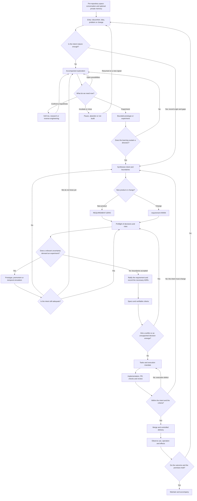

# From discomfort to production

> A proposal for a workflow in which human intent may mature before it becomes a
> commitment, and the commitment may be accompanied all the way to its real
> effects.

**State:** proposal for discussion, not an already approved policy.

**Methodological entry:** [METHODOLOGY.md](../../METHODOLOGY.md).
**Canonical rules:** [RULES.md](../../RULES.md).
**Documentary map:** [INDEX.md](../../INDEX.md).
The design was authorized for elaboration; that does not automatically ratify
operational details or the commitments of a future product.

## 1. What this method seeks to correct

Work may begin with dissatisfaction, curiosity, an opportunity, an idea for a
solution or a decision already taken. None of these entries requires fabricating
a discovery story that did not happen.

The method connects creative and exploratory work to spec-driven and task-driven
development. It does not replace an executor such as Spec Kit or OpenSpec: it
defines the context, the intent and the boundaries that executor receives, and
how its results return to the product cycle.

The human is the author and interlocutor of the intent, the initial
representative of future users and the authority over delegated commitments. The
human is not an inspector of every step the agent takes. Their representation of
the users is a relevant source, but it must not be presented as user research
that did not take place.

## 2. Invariants

1. **Companionship before accountability.** A discomfort may be explored without
   a product name, an economic justification, a form or an obligation to continue.
2. **Divergence is not a defect.** Alternatives, contradictions and discarded
   ideas may be useful knowledge; they are not automatically pending tasks.
3. **Provocation has a context.** Grill me may be a structured, deliberately
   intense session or a one-off intervention. Goal, intensity and stop condition
   are agreed; it does not become a permanent interrogation.
4. **Learning is not promising.** Prototypes and simulations neither authorize
   production implementation nor convert hypotheses into observed evidence.
5. **Entry is variable.** A mature initiative starts further along, with explicit
   provenance, boundaries and gaps; it need not repeat rites already unnecessary.
6. **Autonomy has a boundary.** The agent executes inside a mandate and stops when
   it exceeds it, not at every reversible local choice.
7. **Disagreement does not vanish by summary.** Syntheses distinguish the human
   voice, the agent's interpretation, evidence and decisions actually ratified.
8. **Production reopens questions.** Observed effects may trigger new
   explorations, requirements and revisions of the founding premises.
9. **Infrastructure does not define maturity.** Conversing requires no
   repository, product name, slug or branch. Provisional technical identifiers
   may be generated without asking the human for an identity decision.
10. **Documentation has an occasion.** Every obligation needs a trigger, an owner,
    a consumer and a consequence of absence; no whole catalog is demanded at
    entry. The agent prepares the records; it does not outsource filling them to
    the human as a condition for helping.
11. **Documentation is born in plain sight.** Every document created or altered is
    made explicit in the chat, with purpose, substantive content, provenance and
    open points. Drafting is not deciding; presenting is not obtaining proven
    awareness; silence, the existence of the file and a merge do not ratify the
    agent's interpretations.

## 3. Tree of entry, decision and return

The boxes are working states, not departments or mandatory ceremonies. Returns
may cross more than one box.



**Legitimate shortcut:** pre-existing decisions, specs and tasks may lead directly
to the corresponding state, provided the relevant requirements are ratified, the
references are recoverable and the critical gaps are resolved or accepted by the
competent authority. There is no demand to reproduce an unnecessary exploration,
prototype or ADR.

**Absence of earlier documentation:** record a short retrospective base,
identified as such, and submit its interpretation to human ratification. Do not
invent validations, consensus or alternatives supposedly evaluated.

**The birth of the repository is an independent decision:** it may happen during
a prototype, after the ZERO, or may already have happened. It is neither a
condition for exploration nor an automatic consequence of intent synthesis. Apply
the tree and the triggers of the [documentary contract](DOCUMENTARY-CONTRACT.md)
when versioning, collaboration or integrated execution becomes necessary.

## 4. States and minimum evidence

| State | Permitted work | Condition to advance |
| --- | --- | --- |
| Exploration | Converse, diverge, research, simulate, question, pause | The human recognizes a direction that deserves synthesis; the agent alone declaring a conclusion is not enough |
| Exploratory prototyping | Test use, feasibility or another bounded hypothesis | Learning and limitations recorded; decide to discard, experiment again or synthesize |
| Intent synthesis | Prepare the ZERO or a numbered requirement | Recognizable intent, boundaries, gaps and authority identified |
| Preflight | Examine candidate decisions and risks; test scenarios | Material risks examined; blocking gaps resolved and residual risks accepted |
| Commitment | Ratify the requirement and accept the necessary ADRs | Explicit record of the decision and of the documentary revision that was ratified |
| Specification | Describe behavior and verifiable criteria | Traceable coverage of the intent; conflicts returned to the preflight |
| Execution | Decompose and implement under a mandate | PR with evidence proportional to risk and the applicable checks |
| Delivery | Review, integrate, release and observe | Applicable authorizations, recovery strategy and outcome signals |
| Learning | Compare real effects with expectations | Maintain, fix a defect, open a change or reconsider the foundation |

Each state may contain internal cycles. A gap blocks advancement only when it
threatens the validity of the next decision. The person responsible must explain
that link, instead of demanding abstract documentary completeness.

## 5. The position of the human and the agent's mandate

The contract is one of **autonomy bounded by intent**, neither abandonment nor
continuous supervision. The frequency of interaction depends on the work:
exploration may need intense conversation; well-bounded execution may need only
checkpoints.

Before an autonomous stretch, agree on:

- The outcome sought, the ratified references and what may not be altered.
- Permitted actions and the limits on cost, time, access and external effects.
- Delegated decisions and decisions reserved to a person or role.
- Conditions for interruption, checkpoint and closure.
- How to report results without dumping logs or asking for trivial decisions.

**Interrupt:** conflict with the intent, need to widen the scope, evidence that
invalidates a relevant premise, action outside the authorization, a new material
risk, or attempts that reach the agreed limit.

**Do not interrupt by default:** a reversible local choice, fixing a test the
implementation itself introduced, or refactoring within the authorized scope.
The policies of the tool and the repository continue to prevail.

Consolidate related questions in the checkpoint; present alternatives,
consequences and a recommendation. Lack of an answer never means approval.

## 6. Documentary contract and traceability

METHODOLOGY, RULES, INDEX and the prompt and template libraries constitute the
infrastructure of the method, available before the product. The
[baseline](METHOD-BASELINE.md) defines their incorporation into the repo and the
triggers for AGENTS, adapters, skills and MCPs. They are not opening questions to
the creator.

The [documentary contract by moment and action](DOCUMENTARY-CONTRACT.md)
complements this architecture: it foresees repository files, annotations, native
GitHub records, conditional obligations and the events that make them necessary.
The catalog is not an opening checklist.
Its visible elaboration protocol governs all these records: before drafting,
identify each document and its proposal in the chat; afterwards, present the
substantive content or delta, the interpretations and the points that require a
decision. Drafts may be saved as drafts; new commitments do not enter execution
without the applicable ratification. Editorial updates are communicated without a
new approval ceremony. The human need not discover decisions by reading a
surprise diff.

This is the suggested organization for a product that adopts the method. The
example files below are not already filled-in product documents.

```text
docs/
  requirements/
    REQUIREMENT-ZERO.MD
    requirement-0001.md
    requirement-0002.md
  explorations/
    EXP-0001.md
  decisions/
    ADR-0001.md
  specs/
    <native documents of the chosen executor>
  deliveries/
    DEL-0001.md
```

| Document | Responsibility | Must not become |
| --- | --- | --- |
| [Exploration](templates/EXPLORATION.md) | Preserve alternatives, questions and selected learning | A compulsory transcript or an entry form |
| [REQUIREMENT-ZERO](templates/REQUIREMENT-ZERO.MD) | Found the intent, the meaning and the boundaries of the product | An immutable constitution, an exhaustive PRD or architecture in disguise |
| [requirement-NNNN](templates/requirement-NNNN.md) | Ground a change or expansion and its effects on the ZERO | An ID for every atomic requirement or implementation task |
| [Preflight and ADR](templates/PREFLIGHT-ADR.md) | Examine alternatives and consequences; record the decision when justified | A mandatory ritual for every change |
| [Bridge to specs and tasks](templates/SPECS-TASKS-BRIDGE.md) | Translate the commitment into a traceable execution contract | A second, divergent copy of the specs and tasks |
| [Delivery and learning](templates/LEARNING-DELIVERY.md) | Link PRs, release, recovery and observed effects | The assumption that a merge equals success in production |

**Identity:** the ZERO is unique per product. The sequence `0001`, `0002` and so
on identifies change initiatives; it does not replace versions of the ZERO and is
not restarted per release. Before there is a repository, provisional local IDs
suffice and need not be chosen by the human. Reserve the next number through the
repository's coordination when the record is incorporated; do not reuse the IDs
of abandoned initiatives. In concurrent work, resolve collisions before the merge.

**Versioning:** Git history preserves the revisions of the documents.
Ratification refers to a concrete revision: SHA, PR or an equivalent identifiable
record. A material change in the text requires a new ratification; approval of an
earlier version does not authorize scope added later.

**Change of foundation:** a numbered requirement must declare whether it
preserves, extends or contradicts the ZERO. If it alters the foundation, include
an explicit amendment to the ZERO in the same revision set, with reason, effects
and a new ratification. Do not rewrite the past to feign continuity.

**Chain:** intent → requirement and its revision → decision, when necessary →
spec criterion → task → PR/check → release → observation.
One relation may have several destinations. Fixing a bug that restores an
existing contract requires no new numbered requirement; changing the contract
does.

Use stable local IDs for criteria and tasks. Avoid duplicating the native content
of Spec Kit or OpenSpec: keep references and a coverage map. The choice of
executor and its concrete mapping remain open.

## 7. Preflight and simulations that cross time

The first preflight lists candidate decisions, not decisions already accepted.
Provisional choices from a prototype must be identified as such. The preflight may
return to exploration; a spec may also reveal the need for a new ADR.

Apply premortem, experiments and temporal simulations according to risk, not as a
mandatory package. For each selected scenario, record premises, analysis
mechanism, foreseen consequences, invalidation signals and response.

Possible horizons and scenarios: growth or decline in use, accumulated cost,
migration, vendor exit, regulatory change, change of maintainer, data recovery,
accessibility and aging of dependencies.

**Epistemological separation:** a simulated conversation with a user is not an
interview; a scale projection is not a benchmark; a premortem is not an observed
incident; another agent's opinion is not, by itself, independent validation. When
testing is not possible, record the residual risk, the person responsible and the
review trigger.

## 8. GitHub: coordination without turning exploration into a ticket

### Issues and branches

Exploration does not even require a repository, let alone an issue or a branch
per conversation. If the host tool requires a branch or workspace, the harness
supplies a provisional technical identifier; that limitation does not become a
product question.
Publish only the synthesis
selected by the human, without secrets, personal data or private transcripts.
An issue becomes useful when there is work to coordinate; it points to the
canonical requirement and may aggregate experiments, decisions and PRs.

Executable prototypes stay isolated and identified as experimental. Promoting
them to production code requires the same contract of intent, criteria and
review as any implementation; a convincing demo does not waive it.

### PR classes

| Declared class | Expected evidence |
| --- | --- |
| Exploration/documentation | Learning or documentary change and its limits; no claim of functional delivery |
| Experiment/prototype | Hypothesis, procedure, result and isolation of effects |
| Requirement/decision | Proposed revision, divergences and ratification by an identified authority |
| Implementation | Ratified requirement, criteria, tests and relevant decisions |
| Fix | Current contract, reproduction, fix and absence of regression |
| Release/operation | Released revision, authorization, recovery and observation |

A PR may combine classes, but it receives the union of the applicable
requirements. Declaring "documentation" does not exclude checks if there is
executable code. The [delivery template](templates/LEARNING-DELIVERY.md)
contains a block for the PR; it was not installed as a mandatory template of the
repository.

### Proposed contract for GitHub Actions

Actions can verify structure, references and behavior. It cannot certify that an
idea has matured, nor ratify the intent on the human's behalf.

| Proposed logical check | Verifies | Limit |
| --- | --- | --- |
| `workflow-integrity` | Resolvable references, unique IDs, documents required for the class and declared coverage | Presence does not prove semantic quality |
| `scope-policy` | Altered files, effective class and applicable rules, without trusting the author's label alone | A change outside the mandate requires human review |
| Engineering checks | Lint, types, tests, build and other applicable controls | Green tests prove neither value nor coverage of the whole intent |
| Integration gate | Required checks and reviews/authorization of the current revision | Merge does not automatically authorize production deploy |
| Delivery gate | Artifact/revision, environment and release authorization | Operational health does not demonstrate benefit to the user |

These names are an interface design; **they do not exist as new jobs in this
repository**. The future implementation must:

- Keep a stable aggregating check that also runs on documentary PRs and
  explicitly flags non-applicable verifications, without required checks left
  eternally pending by path filters.
- If a merge queue is adopted, cover the `merge_group` event in the required
  checks.
- Apply classification from the diff and a trusted policy, not only from free
  text or editable labels on the PR.
- Treat PR content as untrusted input; do not run code from forks with secrets
  or write privileges. Do not use `pull_request_target` to run the contribution's
  code.
- Adopt minimal permissions and Actions references pinned to verified revisions.
  Do not grant the agent approval of its own exception.
- Invalidate ratifications materially affected by later changes; branch rules,
  authorized reviewers and environments must reflect this.
- Provide for an explicit emergency exception: reason, authority, scope, risk,
  recovery and later review. Do not hide a bypass as normal success.

This design configures no branch protection, environments, merge queue or
access.

## 9. Closing the cycle

Before delivering, define what will be observed, for how long and by whom.
Separate technical health from human outcome. Record what happened, including
the absence of data; an observation window closed without measurement is not
success.

Possible outcomes: maintain; fix a defect; open a numbered requirement;
re-explore the problem; revert the delivery; withdraw the product. Rollback must
respect data and migrations: reverting a binary may not undo irreversible
effects.

## 10. Proportional adoption and decisions still open

A first initiative needs only the records necessary for its next decision. Do not
fill in every template to prove adherence to the method. The templates for the
[constitution of the repository](templates/REPOSITORY-CONSTITUTION.md) and the
[handoff record](templates/PASSAGE-RECORD.md) are prepared by the agent when
their triggers occur, not handed over as opening forms. An initial ZERO may be
short and contain open questions; its ratification depends on them not making
the authorized commitment unviable.

This design still needs a decision from the person responsible for the product
on:

- The specs/tasks executor and the mapping of its native artifacts.
- Real roles, ratification authority and limits of autonomous execution.
- Risk classification and the checks required in each context.
- Merge, release, exception and operational observation policy.

These choices were not made on the human's behalf. The first use of the method
should reveal where it helps and where it creates bureaucracy; the method itself
is revisable.